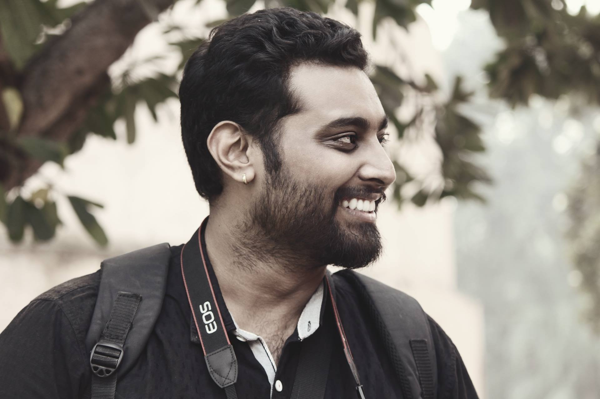
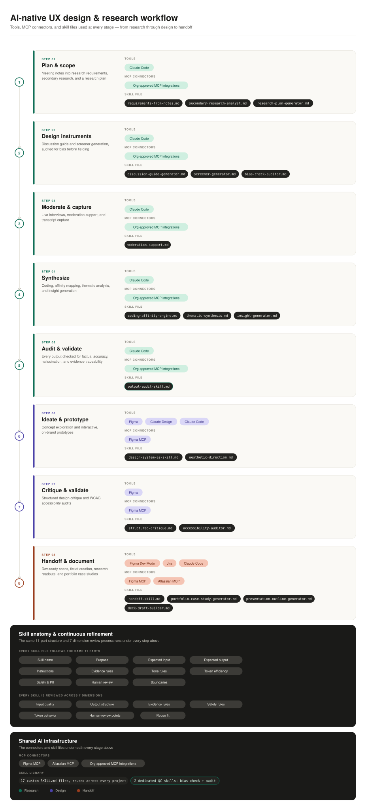

# Gaurav Harsh

## Summary

AI-native UX Designer & Researcher with 6+ years across B2B/enterprise SaaS at ServiceNow and Acuity Knowledge Partners; focused on shipping design decisions, not just informing them.

2+ years working daily with AI tools and MCPs: Claude and Claude Code alongside Figma for research synthesis, prototyping, and design-to-dev handoff. Recently led end-to-end research, IA, and interaction design for an internal enterprise tool, including usability testing and shipping the fixes to production.

## Projects (order as in Notion)

1. My Work at ServiceNow → `../01-servicenow-research-impact/`
2. Municipal Bonds' Analysis Made Easy → `../02-municipal-bonds/`
3. Researching AI Native Experience for Security Analysts → `../03-soc-ai-native-research/`
4. AI Enabled Solution for Editing → `../04-aise-ai-editing/`
5. The Mystery of International Flights → `../05-international-flights/`
6. Connecting with Ni:Shabd → `../06-nishabd/`
7. Aarogya Setu - Official UX Research → `../07-aarogya-setu/`

## Personal Achievements

- Led the recruitment and selection of a talented team of UX designers.
- Created and delivered educational materials on research and usability testing to the UX community and trained junior designers in research methods.
- Initiated and facilitated weekly "community connect" calls to discuss, brainstorm, and ideate on design problems with the UX community.
- Conducted workshops and gave presentations on design process enhancement to management teams, raising awareness of the importance of user-centred design.
- Created proof of the effectiveness of research, which convinced the company to sign a deal with a major research platform.
- Guided the UX, product owner, and marketing communities in using the research platform.
- Advocated for creating a well-researched design system and helped the design team research and create it.
- Helped the UX team transition from XD to Figma by setting up a design document process.
- Introduced and utilised various Figma capabilities to improve design handoffs to developers.
- Represented the community in art competitions, winning consecutively for two years.

## Closing note

Thank you for joining me on this exploration of my journey as a UX designer & researcher. I am incredibly passionate about creating user-centred experiences that make a positive impact. I have consistently achieved meaningful outcomes for diverse projects through my expertise in user research, collaboration with cross-functional teams, staying updated with industry trends, and effective feedback management.

Feel free to contact me with any questions or opportunities to collaborate. I look forward to connecting with you and being a part of your journey to crafting exceptional user experiences.

## Contact

- Email: gauravharsh.design@gmail.com
- LinkedIn: https://www.linkedin.com/in/gharsh22/
- CV: `cv/resume.md` (text). Public PDF still needed, without phone.
- Phone: never publish.
