# My Work at ServiceNow

## Overview

- **Role:** Senior UX Researcher, SecOps · ServiceNow
- **Duration:** 2 years (on top of 4+ years prior across UX design & research)
- **What this page is:** How I built an AI-native research workflow, and the decisions it's helped other teams act on across 5 recent projects.
- **See also:** My design case studies — 3 years as a full-time UX Designer, where the craft/interaction work lives.

## Impact at a glance

> 🎯 **5 different teams took 5 different confirmed actions** — not recommendations that sat in a deck.

| Team | Action taken |
|---|---|
| Inbound PM team | Added a dedicated migration tool + 3 other roadmap items — **4 for 4** insights picked up |
| Product Content team | Now centralizing the fragmented resource hub I flagged |
| Outbound PM team | Built a new tier-awareness messaging strategy |
| Strategic PM team | Greenlit a net-new AI-assisted implementation agent |
| Design team | Confirmed a specific interaction fix for a 39.8%-success task |

## Impact Across Projects

### Shaping a product roadmap directly with PMs

For USEM, I ran **14 focus groups + a 3-day workshop with 15 enterprise customers** testing a static prototype pre-launch. I split feedback into two buckets: what validated the existing roadmap, and what was genuinely new.

**The anchor example:**

- Customers across multiple sessions raised the same worry: losing existing rules, findings, and remediation mappings during migration to USEM.
- I read this as a single adoption-blocking risk, not scattered noise, and flagged it that way.
- The **Inbound PM team** added a **dedicated migration tool** to the roadmap in response.

**It wasn't a one-off:**

- Flexible service mapping (uneven CMDB maturity across customers)
- Instance-level integration status visibility
- A notification system for critical risk changes
- **All 4 net-new insights were picked up onto the roadmap.**

*The throughline: I decide what's signal vs. noise at the moment it matters — precisely enough that PMs change what they build.*

### Turning fragmented cross-functional signal into a decision-ready roadmap

- Planned, facilitated, and synthesized the **SecOps Partner Roundtable** myself — 18 implementation partners across 10 firms.
- For the Implementation Research study, I personally **prioritized every recommendation** by effort/impact weighed against pain-point severity, then assigned each to the team responsible.
- Not binding — but it largely held: **Product Content team** is centralizing the resource hub I flagged, **Outbound PM team** built messaging off this research, **Strategic PM team** greenlit an AI-assisted agent.

### Reframing the problem before recommending a fix

- Before this work: generic language — *"integration challenges," "integration problems."*
- I coined **"integration tax"** to name what was actually happening — hidden technical debt partners were absorbing.
- Paired with a second framing: *"complexity is being hidden instead of managed."*
- **The term stuck** — multiple teams now use "integration tax" without me in the room.

### Designing evaluative research that catches a specific breakage pre-launch

- Designed the USEM focus group study myself; ran a UXQ usability study (company-standard methodology).
- Found Task 3, "Handle Blocked Remediation," succeeded for only **39.8%** of participants — lowest of 6 tasks.
- Traced it to one mislabeled action: *"Start an investigation"* gave no clue it was the blocked-remediation entry point.
- Recommended renaming to **"Unblock."** The **Design team** confirmed they'll implement it.

### Mapping where AI can safely act in a SOC analyst's workflow

- My most recent study: 6 Tier-2 SOC analysts, one-on-one interviews on how they use AI in their own investigation workflow today — run through the workflow described above.
- Landed on a sharper reframe than "analysts don't trust AI yet": you can't optimize for speed and evidence-gated trust on the same alert — the right trade-off depends on the incident type.
- Turned this into a stage-by-stage journey map (Automate Now / Evidence-Chain Required / Human-Only) the team can act on directly, instead of a general directional recommendation.
- Full case study → `../03-soc-ai-native-research/`

## What's next

I'm looking for **Senior UX Designer**, **hybrid Design+Research**, or roles where AI-native process design is part of the job — places where turning ambiguous, cross-functional signal into a decision people actually act on is the job, not a side effect of research. This page is the "how I think" evidence. My design case studies are the "how I build" evidence, and the AI-native workspace case study is the "how I operate" evidence.
