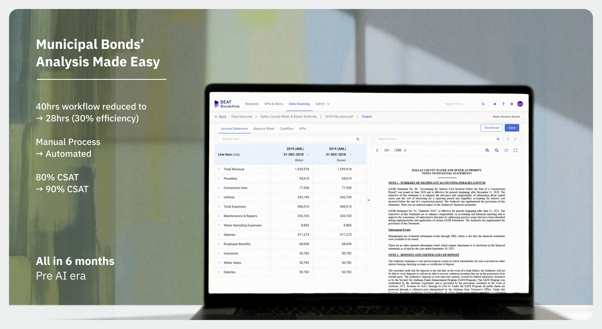
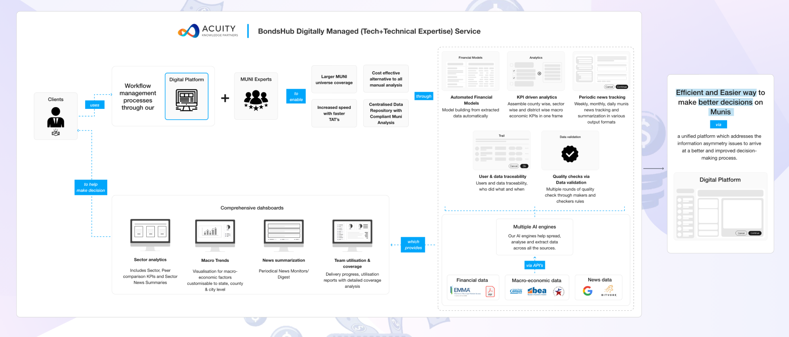
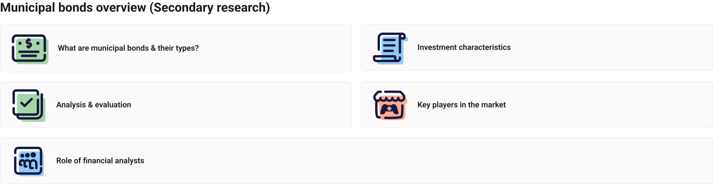
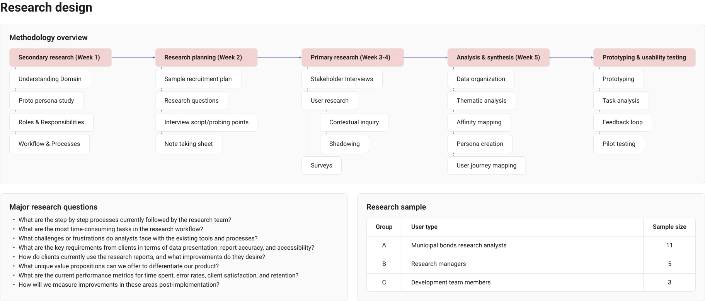
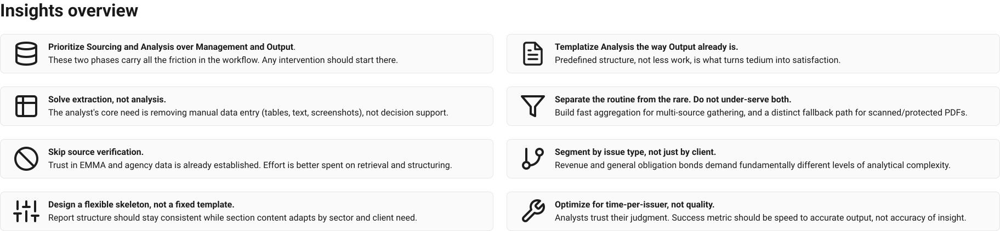

# Municipal Bonds' Analysis Made Easy

## Key User flow (creating obligor's financial model)

> Embedded external object here could not be imported by the connector (likely a Figma/FigJam embed). Add its link manually.

