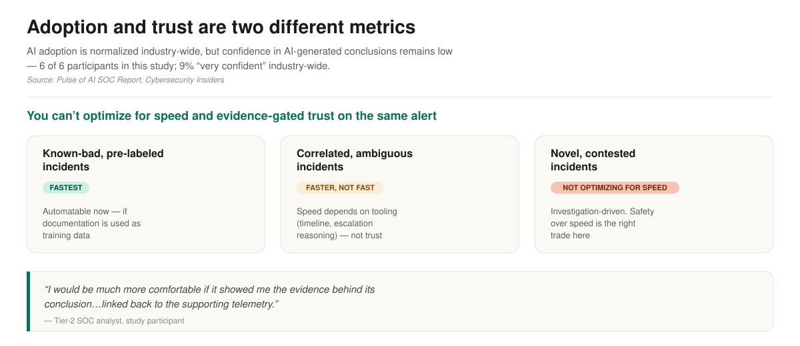
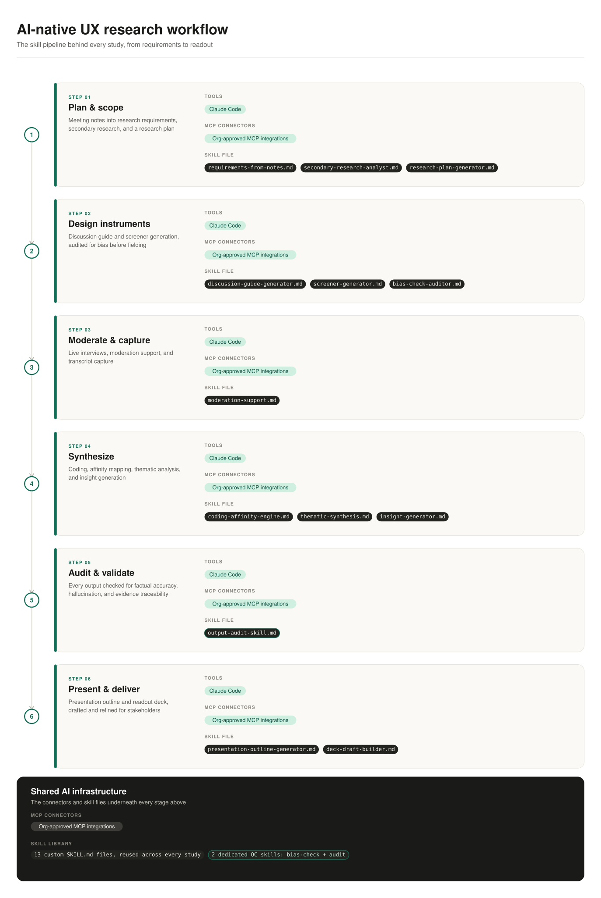
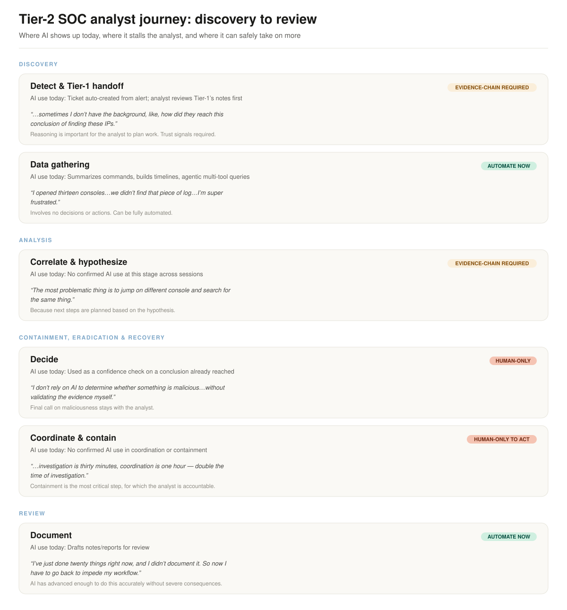
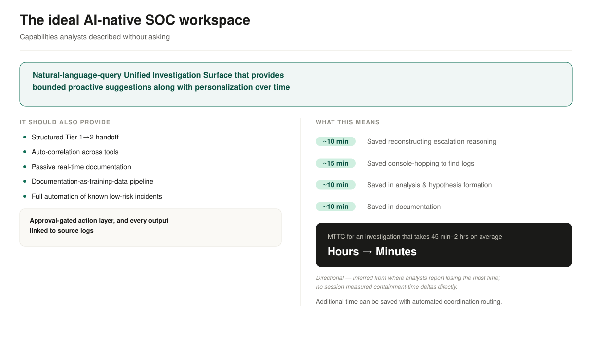

# Researching AI Native Experience for Security Analysts

> 💡 This is a solo research project I ran end-to-end for ServiceNow's SecOps org — from meeting notes to the final readout deck — to figure out where AI can safely take on more of a Tier-2 analyst's investigation workflow.

## The tension

## How I got there

**The study:** 6 semi-structured, one-on-one, 60-minute interviews with Tier-2 SOC analysts across different org models and industries. Every participant used a different mix of company-sanctioned and self-directed AI tools, which gave me a naturally varied lens on how AI actually gets used in security work, not just how it's supposed to be used.

| Session | Role | Org model | Industry | Company-sanctioned AI tools | Personal / self-directed AI tools |
|---|---|---|---|---|---|
| P1 | Hybrid L1+L2 SOC analyst | Tiered (global SOC, interns→L1→L2→L3/L4) | Global SOC (multi-region) | Claude Code (multi-tool orchestration — GitHub CLI, Splunk CLI) | ChatGPT (general summarization) |
| P2 | SOC lead | Single-person InfoSec function | Financial services | Microsoft Copilot (real-time narration → documentation) | Self-built agentic Tier-1 analyst (agentic coding tools, read-only guardrails) |
| P3 | Tier-2 security analyst | Tiered (~4-person team) | Tech / cloud | Claude Code | Claude (documentation) |
| P4 | Incident response analyst | Tireless, end-to-end ownership | Financial services | Microsoft Copilot | Claude (dashboard creation, investigation help, translation of foreign-language DLP content) |
| P5 | Tier-2 SOC analyst | Tiered, mature SOC | Financial services | Microsoft Copilot | Claude, Microsoft Copilot, ChatGPT (script/command explanation; never with sensitive data) |
| P6 | Cloud security analyst | Small, single-manager | Logistics | Claude — Pro subscription (not enterprise-controlled) | Self-built automation agent (daily threat-intel news digest) |

## The part I didn't expect to matter as much as it did

Halfway through synthesis, I noticed something: the thing analysts kept asking for from AI — *"I would be much more comfortable if it showed me the evidence behind its conclusion...linked back to the supporting telemetry"* — was the same discipline I'd already built into my own research pipeline before I knew that's what they'd say.

I hadn't just chained skills together for speed. I'd added a dedicated **bias-check skill** that audited my discussion guide for leading or loaded framing before it ever reached a participant, and a separate **audit skill** that checked every AI output at each stage of the pipeline for factual accuracy, hallucination, and evidence traceability back to source.

The study's own conclusion — trust requires evidence-linking and bias-checking, not just speed — was already a constraint I'd designed my own process around. That wasn't a coincidence I noticed after the fact; it's the same standard I hold my own AI-assisted work to by default.

## The framework

The deliverable that made this actionable for the team wasn't just the insights — it was a **Discovery → Analysis → Containment/Eradication/Recovery → Review journey map**, with every stage of the Tier-2 workflow classified into one of three zones:

- **Automate now** — data gathering and documentation. No decisions or actions involved; AI has advanced enough to do this accurately without severe consequences if wrong.
- **Evidence-chain required** — detection/handoff and correlation/hypothesis stages. Reasoning needs to be visible and trustworthy because the analyst plans real work off it.
- **Human-only** — the actual decision on maliciousness, and coordinating/executing containment. Final accountability stays with the analyst; this is where safety has to beat speed.

This gave the team a concrete, stage-by-stage answer to "where should we build AI into the SOC workspace" instead of a general directional recommendation.

## The ideal AI-native SOC workspace

Beyond the journey map, I pulled out what analysts described as their ideal workspace — largely without me asking for it directly. The core shape: a natural-language-query Unified Investigation Surface with bounded proactive suggestions and personalization over time, gated by an approval layer with every output linked back to source logs.

## What happened next

The recommended next step was to validate the ideal AI-native workspace design with customer-side decision-makers, to gauge real buying intent rather than stopping at internal validation.

And the throughline holds end to end: this wasn't just a study about whether SOC analysts trust AI-native workflows — it was research produced by one, held to the same evidence-linked, bias-checked standard the study itself argued was necessary for trust.
