# AI Enabled Solution for Editing

- **Product:** AiSE (AI-enabled Solution for Editing) — a workflow within Acuity Assistant- AI powered assistant (Word plugin)
- **My role:** UX Researcher and Designer — Desirability research lead, sole designer across all three personas
- **Timeline:** 2 months (research to POC in month 1, development in month 2)
- **Team:** Gaurav (UX Research & Design) · Market Researcher · Business Analyst · Product Owner · Dev team
- **Status:** Live, active users

> 🎯 **TL;DR —** Turned a domain SME brief into a live AI product in 2 months. Research reframed the problem from grammar tool to compliance-aware editing layer. Design resolved the adoption risk before a screen was drawn by embedding inside infrastructure users already trusted. No direct competitor addresses the same capability combination.

## The brief that wasn't a brief

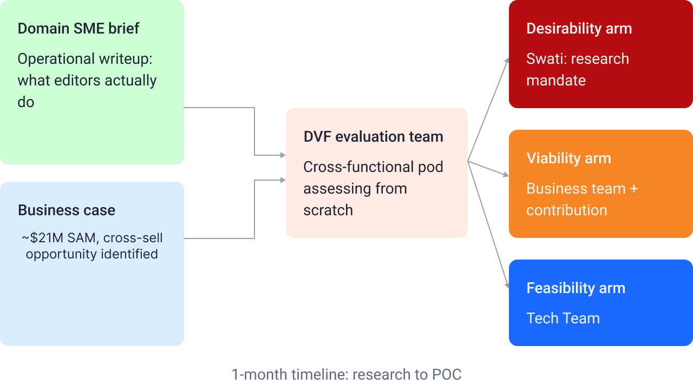

My mandate was the Desirability arm of the DVF evaluation: hypothesis testing, primary research, and synthesis. The SME brief was the seed, not the specification — it gave domain grounding, but it was one person's view shaped by a single vantage point. My job was to test how far that view held when put in front of the people living the work daily.

One hard constraint: research to POC in one month, development starting in month two. No room for iterative exploratory rounds.

## Understanding the work before designing for it

Two findings complicated the initial picture — and both had direct design consequences.

**Finding 1 — AI already in use, but not trusted to act alone.** Majority finding — 8–10 of 12, both cohorts. ChatGPT and Gemini already in informal use, but every participant who mentioned AI also named oversight as a requirement. Not resistance — domain-specific caution. Financial research carries regulatory risk; no one would accept AI output without a review layer.

**Finding 2 — Plugin-not-standalone preference.** Strong majority — 9+ of 12 participants, consistent across both cohorts. Participants were explicit: a tool inside Microsoft Word, not a separate platform. A new tab, a new login, a new interface would add friction rather than remove it.

> 💡 Users were not asking for AI to replace editorial judgment. They were asking for AI to handle the repeatable, rule-based checks — so that their attention could go to the decisions that actually require domain expertise.

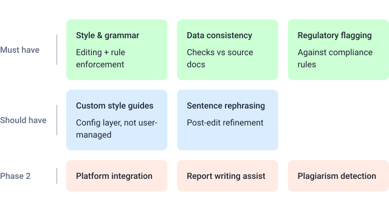

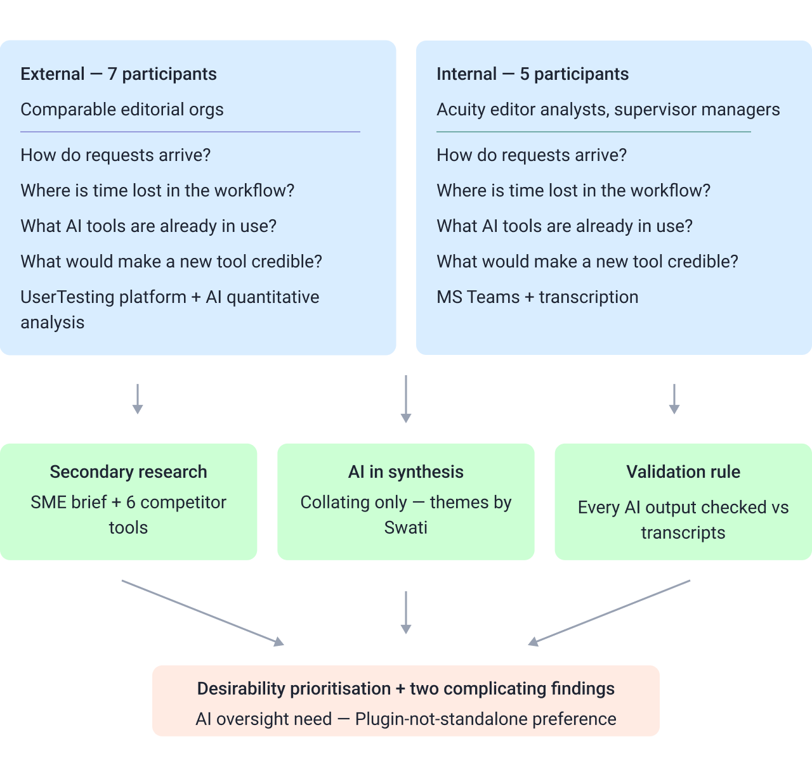

**Core interview questions (asked across both cohorts)**

- How do editing requests currently arrive, and how do you track them?
- Where does time get lost in the editing workflow?
- What tools are you already using — including any AI tools?
- What would make a purpose-built editing tool credible enough to trust?

Style guides rated lower — expected at the configuration layer, not user-managed. Sentence rephrasing and platform integration rated High but were Phase 2, not blockers.

One gap: no quality baseline existed. Users evaluated editing quality through review cycles, not metrics — making a pre-intervention benchmark impossible. The 40%+ TAT reduction projection needs post-launch data to validate.

**On synthesis method:** Themes were built bottom-up using affinity mapping — observations clustered from transcripts, then validated by re-reading source material. AI tools were used for collating and paraphrasing during reporting only. Every AI-assisted output was checked against transcripts before findings were carried forward.

## The strategic problem nobody had named

The research confirmed the operational pain — and surfaced a structural gap nobody had named: every competitor had drawn the same boundary, and it was the wrong one.

The research validated this gap from the user side. Regulatory checks and data validation happened entirely outside any tool — manual, judgment-dependent, and caught late. Several participants described data inconsistencies across charts and tables being found after a document had already moved forward in the review cycle.

One constraint: competitive analysis was desk research, not live product testing. The feature matrix gives a credible picture of the market ceiling — not how tools perform in financial editing contexts, or how close any competitor is to shipping their roadmap capabilities. The whitespace conclusion is sound — but needs monitoring.

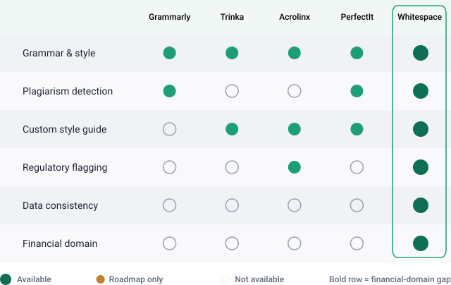

## Finding a home: the product form problem

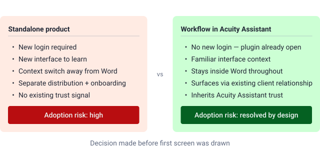

Before a single screen could be designed, there was a problem that had nothing to do with UI: AiSE could not exist as a standalone product.

Embedding AiSE within Acuity Assistant resolved the adoption problem before design started. Infrastructure and trust already existed — clients would access it as an extension of something they were already using.

This constrained design productively: navigation patterns, component library, and visual language were largely fixed. The work was about extending coherently, not originating. Under the hood, AiSE runs through AgentFleet and Acuity Assistant — powerful backend, familiar front-end.

These decisions were taken as hyposesis and tested with 7 external users over Usertesting.com.

## Designing the workflow

The design covered three personas, all screens, information architecture through high-fidelity prototype. The Editor Analyst was the MVP focus — the user who triggers the editing run, reviews AI output, and makes the final call on every change.

Three significant design problems in Steps 4–6 (the designed experience):

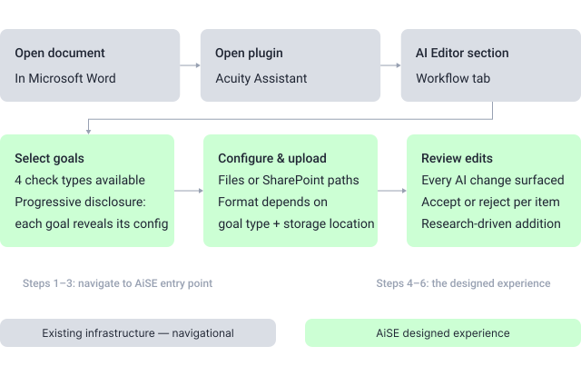

### Design problem 1 — Goal selection

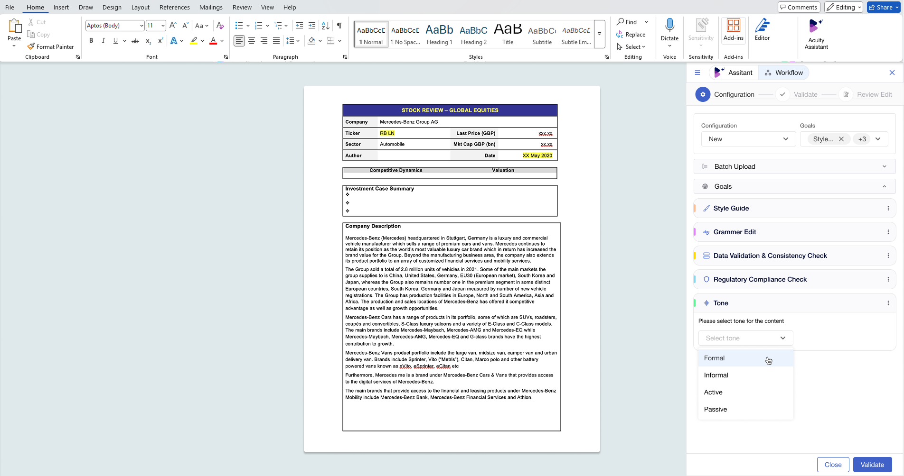

Four goals (Style & Grammar, Data Validation, Regulatory Flagging, Plagiarism Detection) each expose different config fields. Solution: progressive disclosure — selecting a goal expands only its relevant configuration section.

### Design problem 2 — Upload configuration

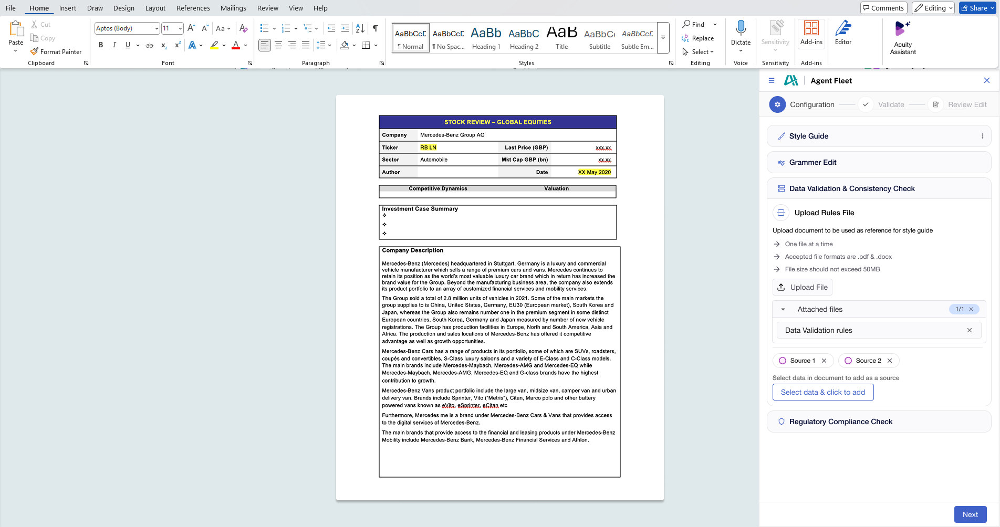

Each goal requires different reference material. Two parallel upload paths: direct file upload for local files, SharePoint path linking for shared drives. This matters because regulatory guideline books and client style guides live on shared drives — requiring local upload would force unnecessary downloads and create version-control risk.

### Design problem 3 — Post-edit review

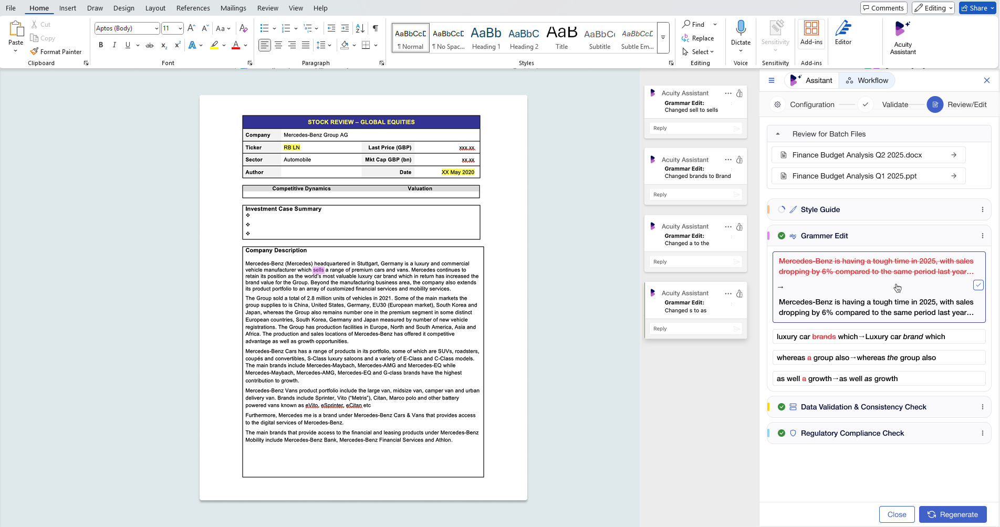

The most research-driven design decision. Users needed human oversight over AI output, so the output couldn't be a finished document. Every AI-suggested change is surfaced explicitly with context, with individual accept/reject control per item.

> 💡 The accept/reject validation step was a design response to a clearly evidenced user need — not a feature request from the product team. It changed the structure of the flow.

The rephrasing layer sits on top as a post-edit refinement tool — a research-rated High capability kept out of the core flow.

Three personas scoped: Editor Analyst (MVP focus), Requestor Analyst intake flow, and Supervisor Manager review flow. All working within Acuity Assistant's existing visual system — extending where patterns had gaps, not replacing.

One unresolved constraint: the configuration step requires users to have the right files accessible before they begin. Missing style guides or unlinked SharePoint paths turn configuration into a blocker.

## Testing at speed

Two rounds. Neither was as rigorous as the timeline deserved. usertesting.com was bypassed for Round 2 — internal users were unfamiliar with the platform, and setup would have consumed time that wasn't available.

- **Confirmed:** Flow was intuitive, minimal training required — validating the embedding decision for the internal cohort.
- **Surfaced:** Performance issues under real document conditions and questions about output accuracy. Neither surprising for an early build, but both require post-launch monitoring, not post-launch discovery.

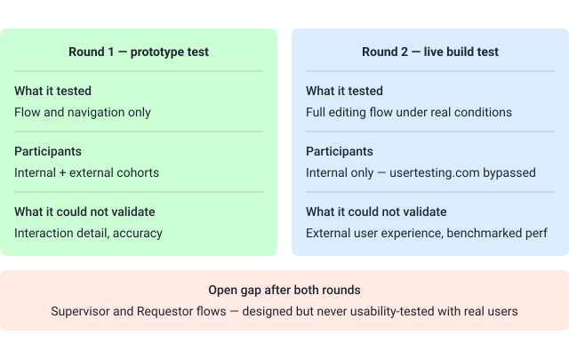

## What shipped and what it cost

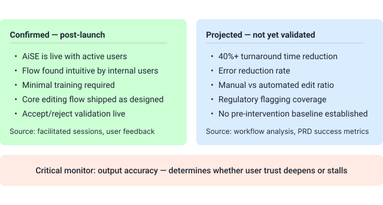

> 💡 Users entering this workflow are quality gatekeepers under regulatory exposure. A high false-positive or false-negative rate on regulatory flagging or data checks will erode trust faster than any UX issue. The accept/reject validation layer gives users the mechanism to override AI errors — but only if they catch them.

Most of what was designed shipped — in a domain with no direct competitor matching the same capability combination. Output accuracy is the critical variable: a tool that flags incorrectly or misses data inconsistencies creates more work than it removes. The research surfaced this risk early; it needs active ownership, not passive monitoring.

The structural debt of the two-month timeline, named plainly:

- No second design iteration cycle
- Supervisor and Requestor flows shipped without usability testing
- File format edge cases unresolved

None of it was invisible — it was the deliberate price of speed.

Cross-BU applicability is worth watching. The capability set isn't unique to sell-side research — whether it replicates across document types and regulatory frameworks is a live post-launch question.

## What I'd do differently

> 💡 The research held. The core design decisions held. What this project is still missing — and what the next six months of live usage will either surface or resolve — is the measurement infrastructure to know whether the outcome matched the ambition. That's not a research failure. It's a handoff failure, and it's mine to own as much as anyone else's.

**I'd have tested the live build with external users.**

Credible for the internal cohort. Untested for a new client's editor encountering the plugin cold, without institutional context. For a product with a cross-sell proposition, that gap isn't trivial. The external cohort shaped the direction — they should have seen the solution too.

**I'd have established post-launch measurement ownership before launch, not after.**

The PRD defines success metrics. What wasn't locked in:

- Who owns measuring them
- At what cadence
- Against what baseline

The 40% TAT reduction sits unverified — not because data doesn't exist, but because no one was accountable for collecting it. Baselines need to be set before launch, not after users have already adapted.

**On design: nothing I'd reverse, but two things I'd finish.**

- **Supervisor and Requestor flows** — designed from user stories and domain logic, never usability-tested. Editor Analyst absorbed the available testing time; that prioritisation was right. But two of three personas shipped without observational validation.
- **Configuration error states** — what happens when a regulatory document is missing, a style guide upload fails, or a SharePoint path can't be resolved. The happy path is solid. Failure states were designed to minimum viable level, and edge cases in enterprise workflows are rarely as rare as the design assumes.
