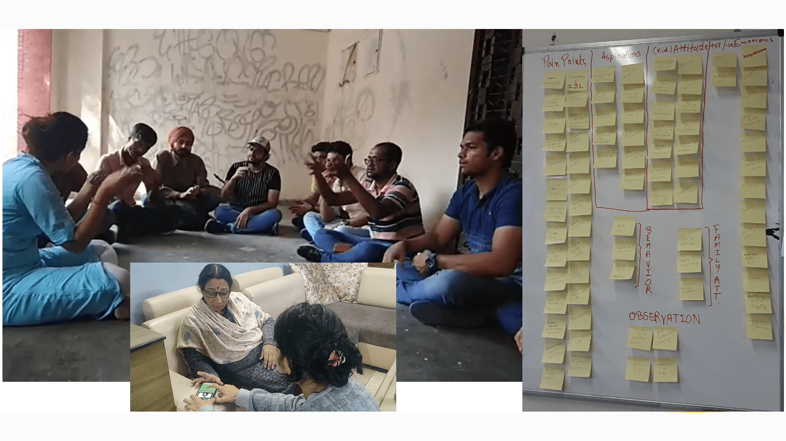
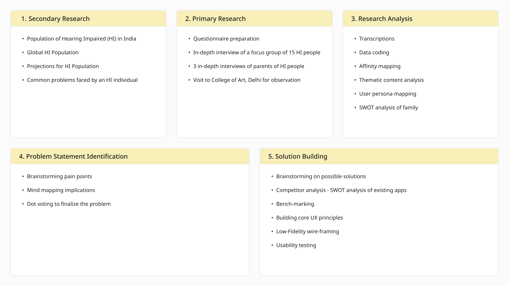
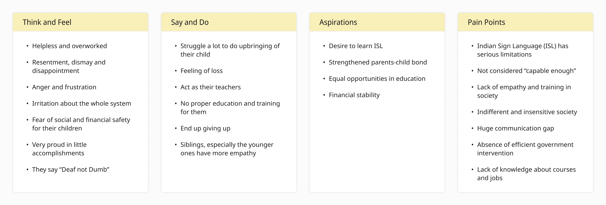
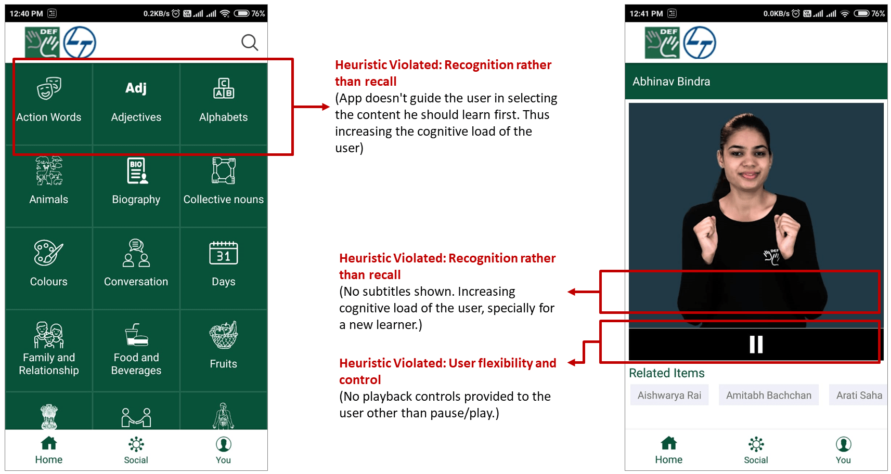
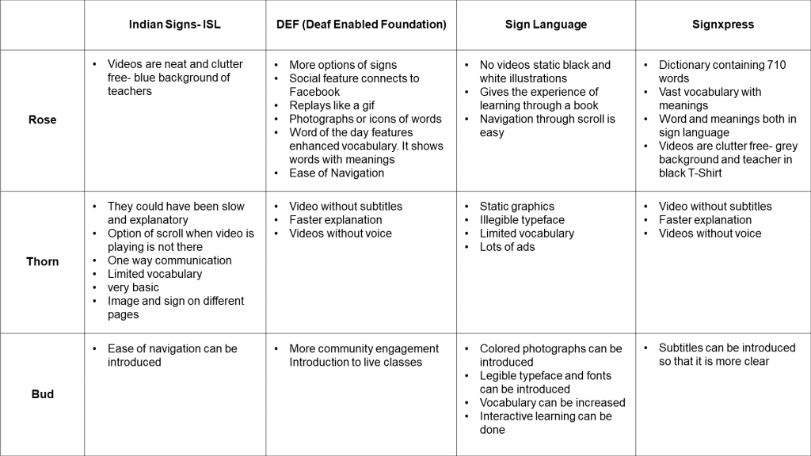
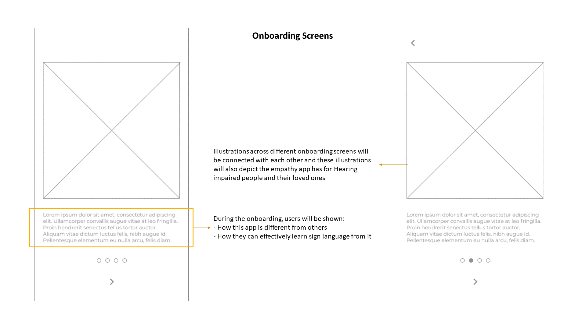
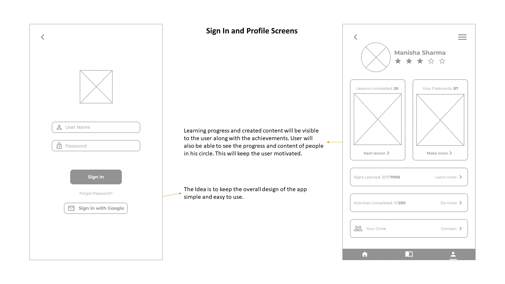
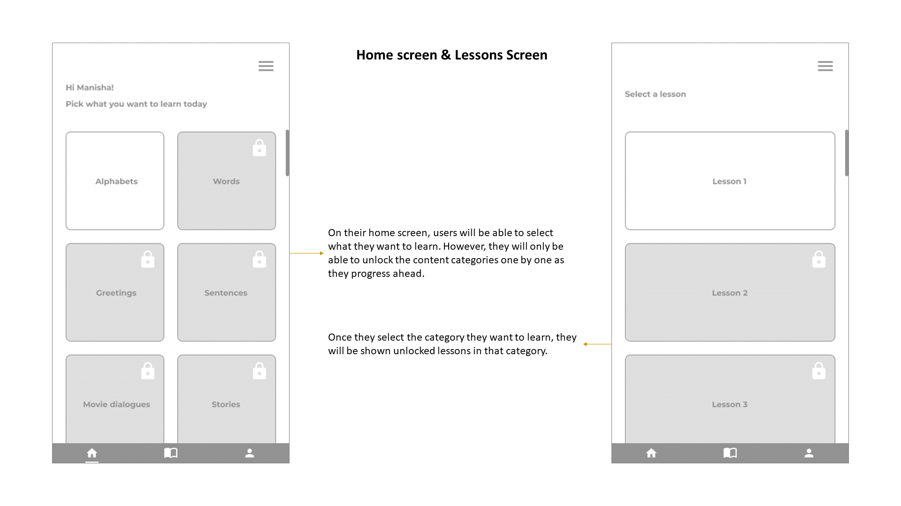
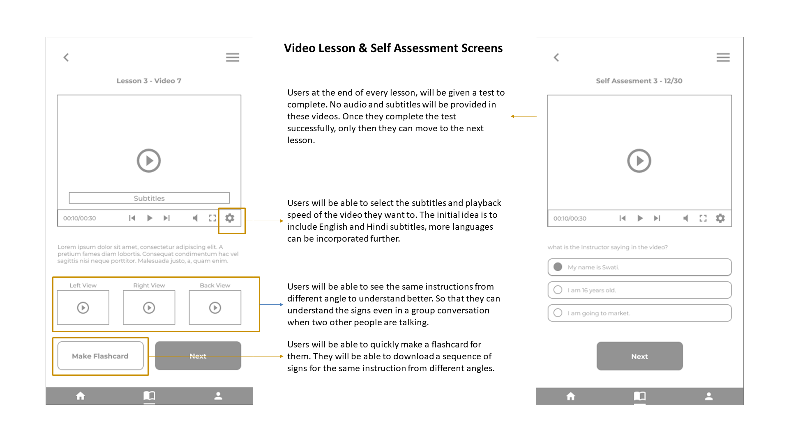

# Connecting with Ni:Shabd

## Introduction to Ni:Shabd

Ni:Shabd is a sign language learning app that uses the double diamond design innovation approach. It allows anyone who wants to emotionally connect with a hearing-impaired person to communicate with their loved ones. The term "family" here refers to individuals who may be the only ones to understand the hearing-impaired person's unexpressed desires, deep thoughts, and life concerns. With Ni:Shabd, family members can learn Indian Sign Language in both English and Hindi.

## What problem does it solve?

Numerous resources exist for hearing-impaired individuals to learn and use sign languages, such as books, schools, institutes, websites, and mobile applications. Unfortunately, communication can be ineffective as those they aim to communicate with may not understand the language. This can lead to emotional disconnection, which is particularly severe when parents cannot comprehend their child's language, resulting in isolation and depression.

The only solace may be found in the company of other hearing-impaired individuals. This problem persists because many parents do not know sign language and may face difficulties learning it due to mental conditioning or a lack of understanding of the English language, in which the language is often taught.

## Identification of the problem and its solution

> ❓ **Problem Statement -** How might we bridge the existing communication gap between hearing-impaired individuals and their families?

Video: https://youtu.be/hOTGlVRvCd8

## Empathy Mapping

## Heuristic Evaluation and Rose-Bud-Thorn analysis of existing apps

## Ni:Shabd's Core UX Principles

Ni:Shabd is a learning app whose user base mainly comprises adults. Adults have different mental conditioning compared to that of children. Thus, Ni:Shabd follows user experience-oriented andragogy instead of pedagogy. The following are the UX principles:

- Instructions should be task-oriented instead of focused on memorization.
- Establish a physically and psychologically conducive learning atmosphere for learners.
- Help learners determine their level of competency in the area of interest.
- Involve learners in mutual planning.
- Involve learners in learning evaluation.

## List of Features

- Community of learners and experts
- Short duration lessons
- Chat based learning
- Flashcards and content creation by the community
- Stories and different scenarios
- Contextual Visual content
- Word of the day
- Subtitles in Hindi and English
- Dictionary
- Easy games tailored for adults
- Audio in English
- Description of every word in a sentence.
- Level badges

### Lo-Fi Wireframes

