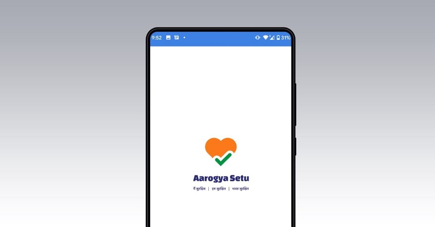
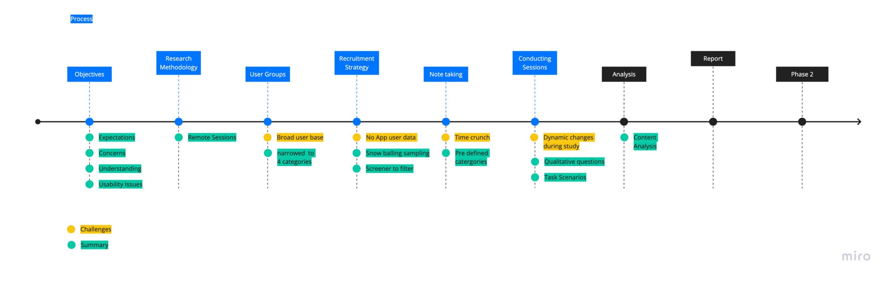
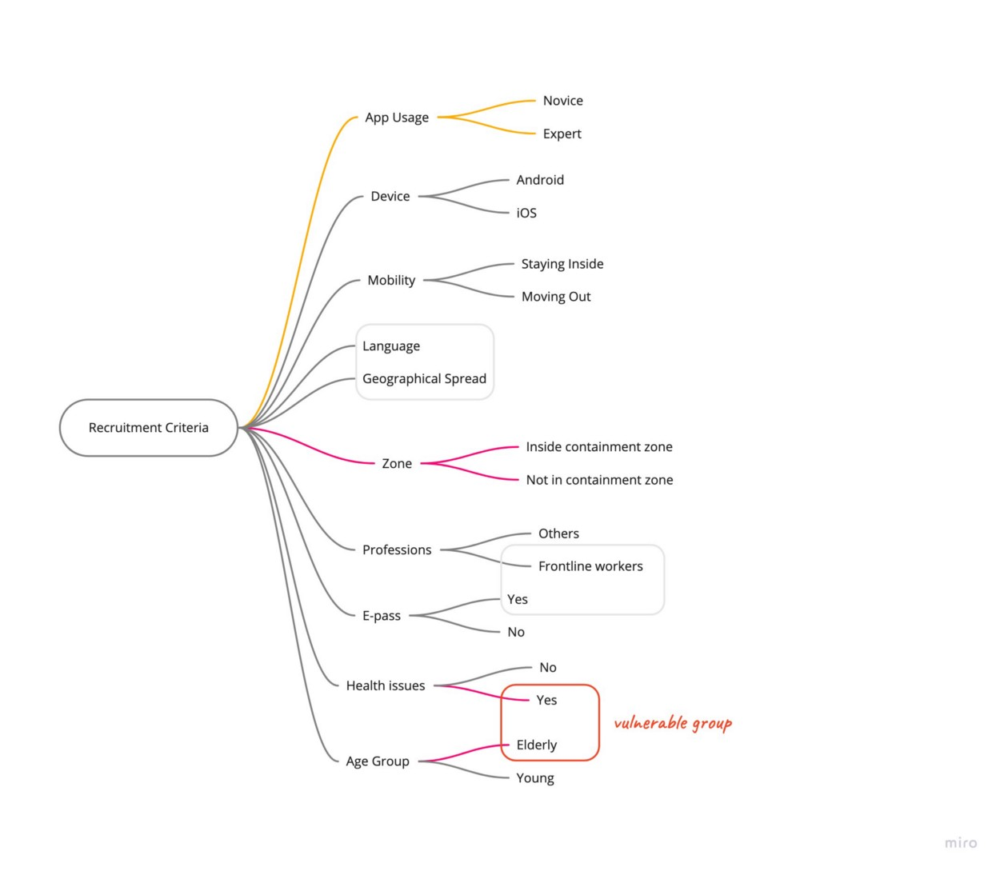
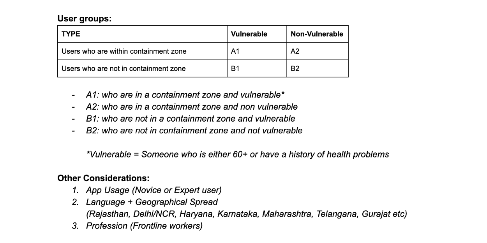
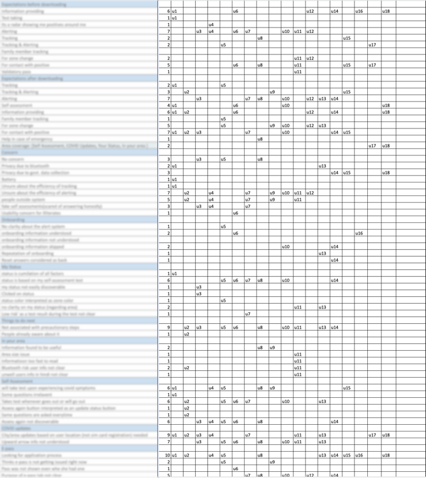
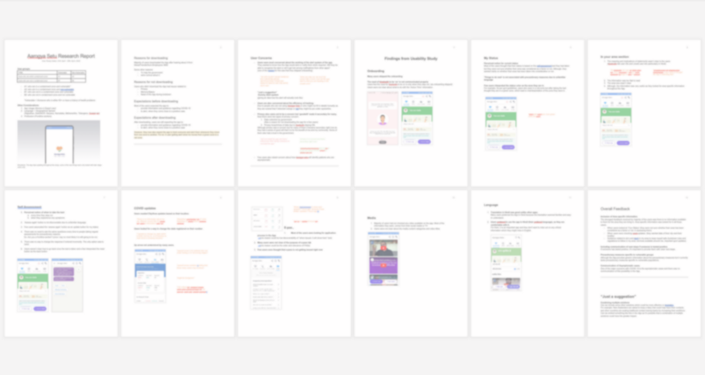

# Aarogya Setu - Official UX Research

## Introduction

**Aarogya Setu** is a GOI initiative, designed and developed by the National Informatics Center team in a partnership with MMT. The App was aimed at augmenting the initiatives of the Department of Health, in proactively reaching out to and informing the users of the app regarding risks, best practices, and relevant advisories pertaining to the containment of COVID-19. The app was launched in early April 2020 and the end of the month was the right time to connect with users to do a quick evaluation for the team.

## Project Overview

- **Aim:** To do a quick UX Evaluation for Aarogya Setu
- **Methods:** Mixed Method Approach, Qualitative interviews, Remote Usability Testing, Content Analysis, First Click Testing
- **Skills:** Interviewing, synthesising, facilitating, presenting, design critique
- **Deliverable:** Insights Report
- **Team:** I (UX Research Intern), Vidushi Pundir (UX Researcher at MMT), Shipra (Independent Researcher)
- **Duration:** 1 week

## Challenges

**The broad user base:** For an app that was downloaded by 50+ Million people within the first 3 days of its launch, considering this broad user base we needed to be smart with defining scalable user groups for the study.

**Lack of Data:** Although everyone was a user here, the access to actual user groups who were at higher risk was restricted and unlike other times we did not have the current user data so we relied on snowball sampling for those groups.

**Limited time-frame:** The time and scale of this project were unlike other research projects. Because of high stakes things were kind of happening at the speed of light. And we needed to ensure that our research matches up with this speed and we had to think about how can we provide the product teams with quick quality evaluations.

**Agile updates during the study:** Because the things were so fast-paced and designing for a global crisis meant staying up-to-date during these uncertain, changing times and needs. This brought in a lot of agile interface changes during the course of the study.

### Takeaway

**As the App kept updating throughout the study, which only meant so should our research protocol as we move ahead.**

## The Process

**Objectives:** To understand users' expectations, concerns, and understanding around the App. To identify major usability issues across the App.

**Methodology:** With strict lockdown and social distancing being practised without a doubt, the only option we had was to conduct a remote session and leverage technology at its best. Considering objectives each session was planned for 30–45min.

**Identifying the right user groups:** Considering the broad user base we listed all the key considerations that needed to be incorporated in the user profiles. Then we prioritized the most crucial ones. We combined a few other considerations that were not so important but were good to have use cases. We ensured enough representation across all categories.

**Recruitment Strategy and Screener:** We contacted friends and family and used our Social Media to recruit the users. The screener was prepared and used to categorize and recruit people from these 4 defined user groups. In spite of having no incentive, a sense of goodwill among the participants made our job easy.

**Note-taking template:** Having pre-defined categories in the template while taking notes helped us speed up the process to match the product team's pace.

**Conducting the session:** Each participant was asked qualitative questions and then all were given the task scenarios: Onboarding (First-time users), Checking my status, Self Assessment, Precautionary Steps, Checking COVID Updates, Checking E-pass. Along the way, they were asked to think aloud and provide their expectations and feedback of the interfaces and the features.

**Synthesizing and Analyzing insights:** For the analysis, we used the content analysis method where you quantify and analyse the presence of themes in qualitative data. You can learn about content analysis here: https://www.mailman.columbia.edu/research/population-health-methods/content-analysis. Following the content analysis process, we quickly glanced through the notes and prepared the tally sheets to quantify findings which gave us an idea of emerging themes. Based on it we could find the major pointers. Other important qualitative findings that didn't emerge but still were relevant for the team, were also considered. The sense of urgency meant that we had to keep our "FOMO" of missing out on interesting patterns aside. Having a process helped us rely on it and stick to it rather than getting lost in the sea of data.

### Takeaway

- **It was important to be even more vigilant in finding the right saturation point and not waste time in conducting more sessions.**
- **Based on our objectives, we had already created pre-defined categories and took notes for all the sessions in that template and kept updating it as new interesting stuff came up.**
- **The content analysis comes to the rescue in case of the fast-paced agile environment**

## The Outcome

An evaluation report that was quickly synthesised and complied in 1 day with actionable insights backed by the user quotes.

- The report communicated user feedback on the app's concepts and interfaces.
- We learned that icons, symbols, and wording must be aligned with user mental models.
- The report also reflected on user understanding, expectations, and perceived notions.
- We proposed suggestions and strategies based on our research of other solutions.
- The presentation was shared with stakeholders and govt leaders.
- We were accountable for affecting 60M lives.

### Impact

- The insights persuaded the team to solve user concerns and broke stereotypes.
- The report helped to improve the usability of the app and make it more user-friendly for people from diverse backgrounds.
- The report was a valuable tool for the product team and helped them to make better decisions about the app's design and functionality.
